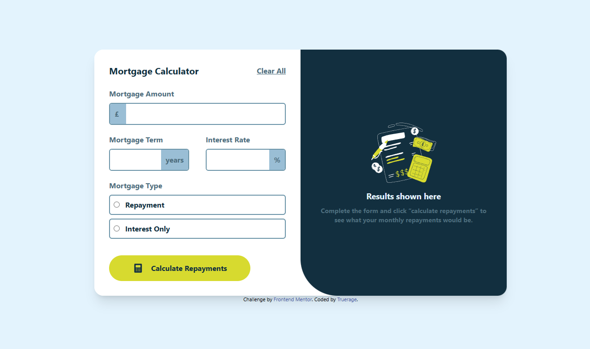

# Mortgage Repayment Calculator

Mortgage monthly and total installment calculator (principal and interest repayment or interest-only). Project from Frontend Mentor.

**Live demo:** https://trueraqe.github.io/mortgage-repayment-calculator

## Functions
- Calculating the monthly installment and the total repayment amount
- Form field validation with error messages
- Keyboard navigation, hover and focus states
- Responsive layout (mobile-first)

## Built with
HTML, Tailwind CSS, JavaScript

## What I learned
- improve tailwind css skills
- improve responsive layout skills

## Author
[Trueraqe](https://github.com/Trueraqe)